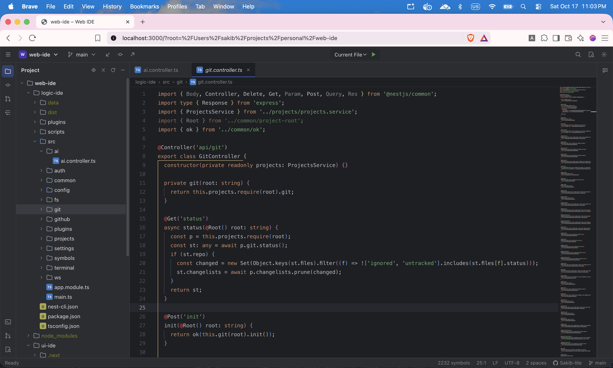
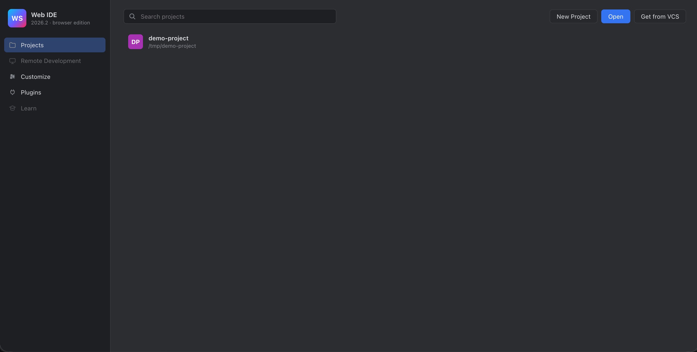
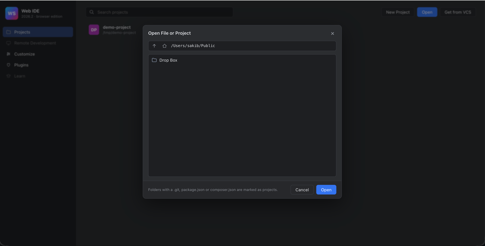
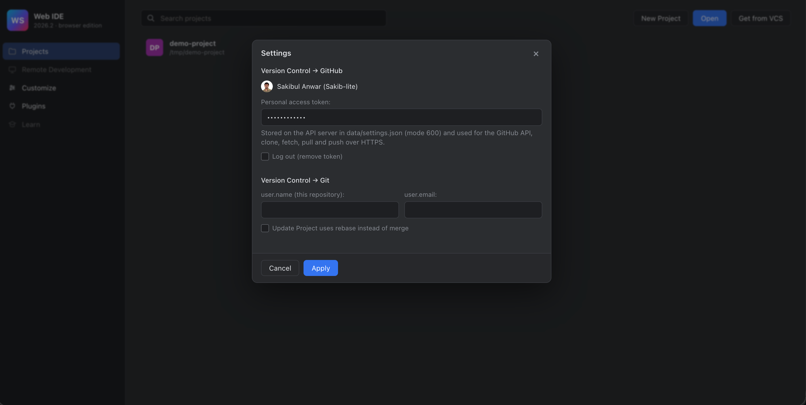
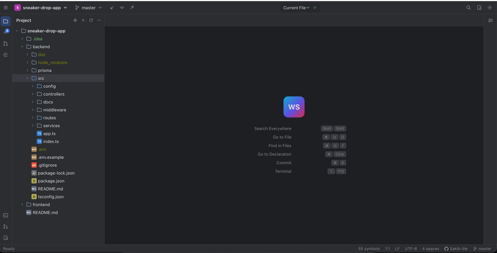
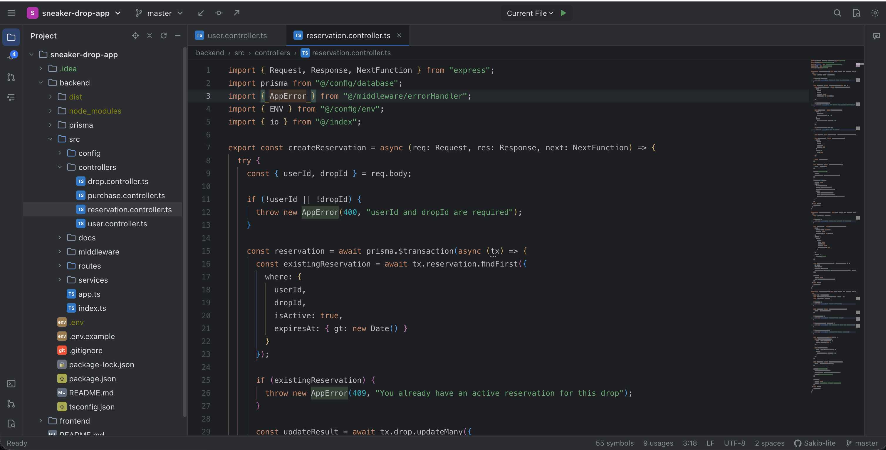

# Web-IDE

A JetBrains-style IDE that runs entirely in the browser, built as a monorepo with a NestJS API (`logic-ide`) and a Next.js UI (`ui-ide`). It gives you a Monaco editor with tabs and diff view, full git integration with a commit window and log graph, a built-in terminal, project-wide search, and a plugin system — all working directly on real projects on your machine.

**Languages supported:** JavaScript, PHP, Python — with symbol indexing, autocompletion, go-to-definition, find-usages and a structure view.







## Run

```bash
npm install && npm run dev
```

Then open http://web-ide.com — run `sudo ./scripts/setup-local-domain.sh` once (after each reboot) to map the domain locally and forward port 80 to the UI; the API runs on port 4099. Without the domain setup, open http://localhost:3099.
